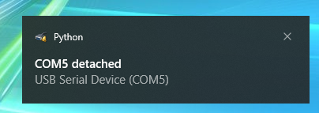

# Serial Port Watcher

A simple cross-platform tool for notifying the user when serial devices are added or removed. The tool shows a popup notification with details on what port was attached or detached.

## Screenshots

Linux Mint Cinnamon 22.3:


Windows 10:



## Requirements

The only requirement is a recent version of Python 3. PIP dependencies are installed automatically on first launch if needed.

## Installation

Clone the repository or download the ZIP file and extract. 

## Usage

To launch the tool use the following commands:

On Windows:
```
./launch.bat
```

On Linux:
```
./launch.sh
```

Upon executing one of the commands above, the tool will launch in the background. An icon will appear in the tray indicating that the tool is active.

To deactivate the tool, right click on the tray icon and click Exit. The tool will deactivate shortly after.

## License

This project is licensed under the MIT license. See LICENSE.txt for details.